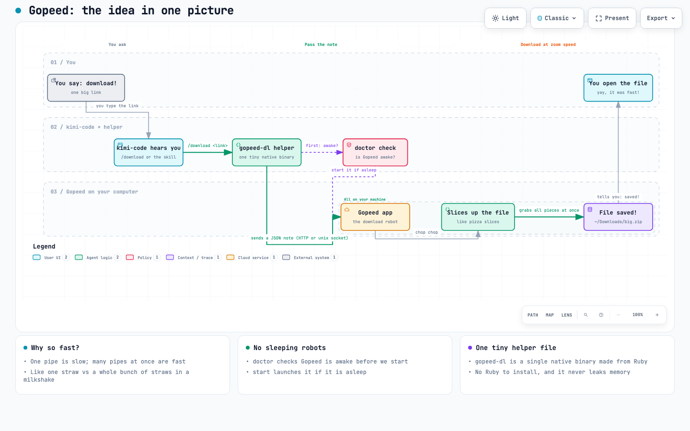
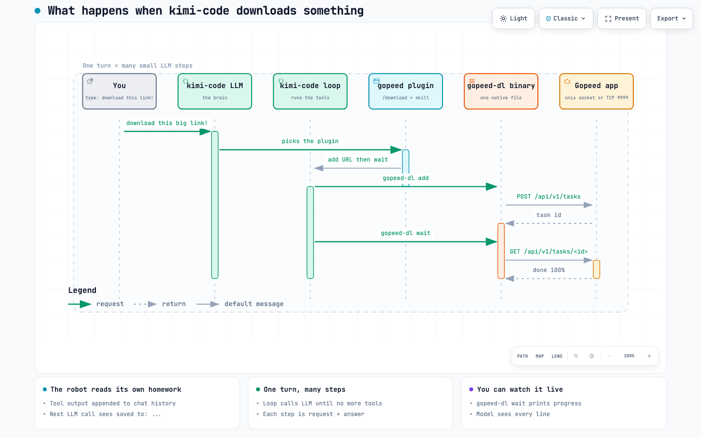

# gopeed plugin for kimi-code

Download things fast with [Gopeed](https://gopeed.com) instead of a slow single-connection `curl`.

## The idea in one picture

```
you say: download this link
        |
        v
gopeed-dl (this plugin's binary) --JSON over HTTP--> Gopeed app on your machine
        |                                                 |
        |                                                 v
        |                              Gopeed splits the file into many
        |                              connections and downloads in parallel
        |                                                 |
        v                                                 v
"saved to: ~/Downloads/big.zip"  <---------------- done!
```



<details>
<summary>Open archify HTML (interactive)</summary>

[`assets/idea-in-one-picture.html`](assets/idea-in-one-picture.html) — zoomable, with Archify's built-in Export dialog (PNG, JPEG/WebP, dual-theme SVG, trace-enabled WebM).
</details>

## What one download turn looks like

When you say "download this", the LLM does not download anything itself. It picks this
plugin's `/download` command (or the `using-gopeed` skill), the loop runs the binary, and
the binary's output goes back into the chat history — so the next LLM step can see
"saved to: ~/Downloads/big.zip" and answer you.



<details>
<summary>Open archify HTML (interactive)</summary>

[`assets/download-turn.html`](assets/download-turn.html) — zoomable, with Archify's built-in Export dialog (PNG, JPEG/WebP, dual-theme SVG, trace-enabled WebM).
</details>

## What is in here

- `src/gopeed_dl.rb` — the tool, written in plain Ruby
- `build.sh` - compiles that Ruby into one native binary with [Spinel](https://github.com/matz/spinel)
- `bin/gopeed-dl` - the finished binary (no Ruby needed to run it)
- `commands/download.md` - the `/download` slash command
- `skills/using-gopeed/` - when and how to use the plugin
- `test/` - a mock Gopeed server + test script, so we can test without the app

## Why Ruby compiled to a binary, not C — and the honest memory story

Short version: both languages can leak; the difference is who does the cleanup.

- In C, when you ask for memory you must give it back by hand. Forget once and that
  piece is lost until the program exits — a leak. The enterprise fix in C is proof,
  not hope: our macshot plugin wraps every allocation in counters and prints
  `live_allocations` at the end, so a leak would show up as a non-zero number.
- In Ruby, a garbage collector (a little janitor) frees every object nobody can
  reach anymore — you never call `free`. Spinel ships that same janitor inside the
  compiled binary (`spinel/lib/sp_gc.c` is a real mark-and-sweep collector), so the
  native file cleans up after itself too.
- The fine print, because we checked instead of assuming: the janitor only sees Ruby
  objects. Memory allocated by C code inside an extension is invisible to it, and
  anything still referenced (say, a growing cache) is kept on purpose. And for a
  short-lived command like this one, the OS reclaims everything at exit anyway —
  leaks hurt most in long-running programs.
- So this plugin proves it rather than hoping: every 10th run (or always with
  `GOPEEDSELFCHECK=1`) it forces a full GC at exit and prints the retained heap to
  stderr. Measured baseline on this machine: ~0.7 MB after a full collection; it
  warns if that ever exceeds 4 MiB. Same standard as the C plugins, zero hidden
  retention.

A note from the author, in his own words (lightly polished):

> Honestly, a native binary is the target whenever I build a plugin, for many reasons you may already know. I've made some in C, but most of my experiments start in Rails, so I can write Ruby just as easily. Big thanks to Yukihiro "Matz" Matsumoto ([@matz](https://github.com/matz) — yes, the creator of Ruby), for Spinel: I get to write in the language I actually enjoy reading, and still ship one real native binary. And honestly, if you ever look at this code and want to suggest an improvement - please do. If it ever ends up as an example in Spinel itself, that would be my honor.

## Setup

1. Install and start Gopeed (app or headless binary). On this Mac the app is at
   `/Applications/Gopeed.app`; the plugin also finds it in `~/Applications`,
   Homebrew (`/opt/homebrew/bin/gopeed`), package-manager paths, flatpak, AppImage,
   Windows Program Files, and anywhere on `PATH` - or set `GOPEED_APP=/custom/path`.
2. No switch needed: with the app's default **Unix** protocol, the REST API answers on a
   unix socket (`~/Library/Caches/gopeed.sock` on macOS, `$XDG_CACHE_HOME/gopeed.sock` on
   Linux) and gopeed-dl uses it automatically — verified live on Gopeed 1.9.3, no token
   required (file permissions guard it). The app also serves the same REST API on TCP
   `http://127.0.0.1:9999` when you set Settings -> Advanced -> Protocol = **TCP**
   (port 9999, restart) - that is also what the headless binary uses:
   `gopeed-web -A 127.0.0.1 -P 9999`, or just `bin/gopeed-dl start`.
   Note: `gopeed_host.sock` under Application Support is the browser-extension channel
   and has no REST routes - do not point `GOPEED_URL` at it.

   **Turn on TCP in the desktop app (optional, ~30 seconds, no extra downloads):**
   1. In Gopeed, click the gear **Settings** (left sidebar), then the **Advanced** tab.
   2. Under **API** there is a **Protocol** dropdown (default `Unix`) — switch it to **TCP**.
   3. Set the port (default `9999`). Optionally set an **API token** here too.
   4. Restart the Gopeed app so the new listener starts.
   5. If you picked a non-default port, tell the plugin: `export GOPEED_URL=http://127.0.0.1:<port>`.
      On this Mac, port 9999 is already held by a headless `gopeed-web` — either stop that
      process or give the app another port (e.g. 9998) to avoid a conflict.
3. Optional (TCP only): set an API token in Settings -> Advanced -> API token, then `export GOPEED_TOKEN=...`.
4. Build the binary: `./build.sh` (needs Spinel once; see below).

## Try it live (real download case)

Precondition: run `/plugins reload` in kimi-code once so the plugin is loaded.

Then paste this to the LLM **without naming the plugin** — the skill's `whenToUse`
should make the model pick it on its own:

> Please download this file for me: https://proof.ovh.net/files/100Mb.dat — save it into
> ~/Downloads and make it as fast as possible. If you have a faster way than a plain
> single-connection download, use it. When it's done, tell me the exact saved path,
> the file size in bytes, and how long it took. If it is still running, give me the
> task id and how to check progress.

The link is verified live from this machine (2026-11-02): HTTP 200,
`content-length: 104857600`, `accept-ranges: bytes`, and a range probe returns
`206` with exactly 1024 bytes — so multi-connection splitting will actually work.
Alternate verified link (66 MB, GitHub release, redirects to Azure, ranges OK):
`https://github.com/git-for-windows/git/releases/download/v2.47.1.windows.1/Git-2.47.1-64-bit.exe`
(69,109,976 bytes). The old Hetzner suggestion is dead from here (connection fails) — do not use it.

Verify afterwards:

```bash
ls -la ~/Downloads/100Mb.dat                 # expect exactly 104857600 bytes
~/.kimi-code/plugins/managed/gopeed/bin/gopeed-dl list
~/.kimi-code/plugins/managed/gopeed/bin/gopeed-dl status <task-id>
```

## Check it works

```bash
bin/gopeed-dl doctor    # app found where? API answering? exit 1 with guidance if not
bin/gopeed-dl start     # launch the found GOPEED_APP and wait for the API
bin/gopeed-dl ping
```

## Use

```bash
bin/gopeed-dl ping                          # is Gopeed up?
bin/gopeed-dl add https://.../big.zip --dir ~/Downloads
bin/gopeed-dl wait <task-id>                # prints progress, ends with the saved path
bin/gopeed-dl list                          # all tasks
```

Env config: `GOPEED_URL` — `http://127.0.0.1:9999`, `unix:///path/to/gopeed.sock`, or unset to
auto-detect (unix sockets first, then TCP 9999). `GOPEED_TOKEN` (X-Api-Token, TCP only),
`GOPEED_SOCK` (extra socket to try), `GOPEED_APP` (app/binary path override).

## Build for another machine (multi-arch)

`build.sh` builds for the machine it runs on and names the binary
`bin/gopeed-dl-<os>-<arch>`. Spinel supports macOS (Intel + Apple Silicon) and
Linux (x86_64 + arm64) natively; for Windows, build under WSL (dependable) or
MinGW-w64 (community, best effort) - see `spinel/docs/windows.md`. In CI, run
`build.sh` on one runner per target and collect the `gopeed-dl-*` files.

## Test

```bash
test/run_tests.sh    # 32 checks against the mock API (TCP + unix socket), no Gopeed needed
```

## Safety rails (v0.2.0 audit)

- A missing or weird task id fails locally - `remove` with no id can never hit the
  delete-everything API route by accident.
- HTTP timeouts (5 s connect / 30 s read), so a hung Gopeed cannot hang the agent.
- Non-JSON or plain-text error replies (HTTP 500) are reported with status + body snippet.
- API token is only ever sent in the `X-Api-Token` header, never printed or logged.
- Percent math uses floats, so huge files cannot overflow the integer math.
- Heap self-check: every 10th run (or `GOPEEDSELFCHECK=1`) a full GC runs at exit and
  the retained heap is printed to stderr (~0.7 MB baseline here; warns above 4 MiB),
  on success and error paths alike — same zero-leak standard as the C plugins.

## What changed in 0.2.0

The audit pass above: id guards, timeouts, friendly HTTP errors, float percent, `--timeout`
validation, per-arch `build.sh` (Windows via MinGW/WSL), 20 mock-API tests.

## What changed in 0.3.0

- `doctor` and `start` commands; the tool finds Gopeed in the native install locations
  (GOPEED_APP override, then /Applications, Homebrew, PATH, flatpak, AppImage, Windows paths).
- Progress display fixed against the real API: total comes from `meta.res.size`, bytes from
  `progress.downloaded` (top-level `size` is null and `used` is an internal counter — the old
  display showed "10.1 GB" for a 35 KB file).
- Verified against a real Gopeed 1.9.3 (`bin/gopeed-web` on 127.0.0.1:9999): doctor, start,
  ping, and a real `add`+`wait` whose output was byte-identical to curl (10,690 bytes).

## What changed in 0.3.1

- **Unix-socket support**: `GOPEED_URL=unix:///path/to/gopeed.sock` speaks HTTP/1.1 directly
  over the socket (own minimal client: Content-Length + chunked, 30 s deadline, socket always
  closed). This is the desktop app's DEFAULT mode — verified live on v1.9.3 that
  `~/Library/Caches/gopeed.sock` serves the full REST API with no token, while
  `gopeed_host.sock` (browser-extension channel) answers "Route not found" for `/api/v1/*`.
- **Auto-detect**: with `GOPEED_URL` unset, endpoints are tried in order — `GOPEED_SOCK`,
  the OS-default `gopeed.sock`, then TCP 9999. An explicit `GOPEED_URL` stays strict.
- `doctor` now reports the app path, token state (set/not set, never the value), and every
  endpoint it tried; `start` also works on Windows (`cmd /c start`); `--timeout` without a
  value is an error. Spinel frozen-string-literal trap fixed (`+""`). 30/30 mock tests pass,
  including unix-socket add/status/remove and live `ping`/`list` over the real socket.

## What changed in 0.3.2

- **Heap self-check**: `at_exit` hook (registered at the top of the file so it also runs on
  error exits — a bottom-of-file hook never registers when `main` calls `exit`) forces
  `GC.start` and reports retained heap via `GC.stat` to stderr. Runs when
  `GOPEEDSELFCHECK=1` or every 10th process (`Process.pid % 10`). Baseline measured on this
  Mac: ~0.7 MB after full GC; warns above 4 MiB. This is spinel's own mark/sweep collector
  doing the counting — the same zero-leak proof the C plugins get from malloc counters.
- README memory section rewritten: the old "C leaks, Ruby GC frees everything" line was
  oversimplified — GC covers Ruby objects only, not C-extension memory or still-referenced
  objects, and a one-shot CLI gets everything back from the OS at exit anyway.
- 32/32 mock tests pass, including self-check present on success and error paths.

## What changed in 0.3.3

- **Command is self-contained and machine-independent**: `commands/download.md` no longer
  hardcodes any absolute user path — it resolves `~/.kimi-code/plugins/managed/gopeed/bin/gopeed-dl`,
  fails fast with a clear message if the plugin isn't loaded (`/plugins reload`), and runs
  `doctor` (all endpoint cases) → `add` → `wait --timeout 600` in one turn.
- **Skill as fallback guidance**: if the natural skill trigger doesn't fire, the inline
  dig-deeper guide covers `ps aux | grep gopeed`, launching the app / `gopeed-web`,
  pinning `GOPEED_URL`, setting `GOPEED_TOKEN`, and polling with `list`/`status`.
- Runtime verified end-to-end: real LLM turn picked `gopeed:using-gopeed` naturally,
  `doctor` found Gopeed 1.9.3 on the Unix socket, and the task was added.
